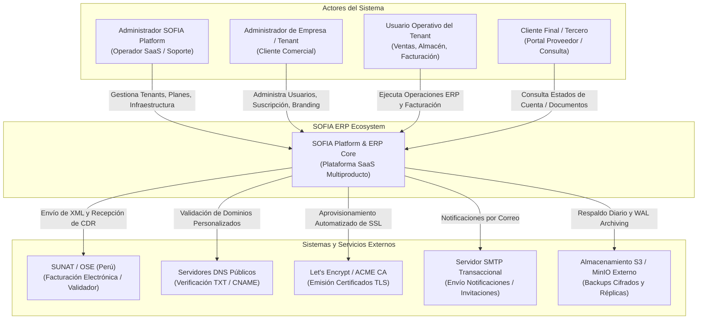
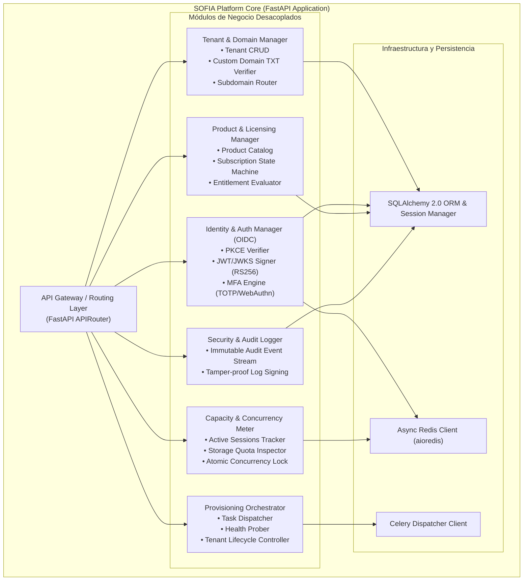
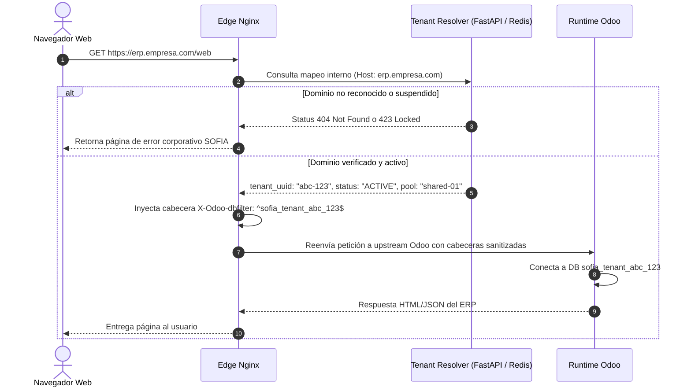
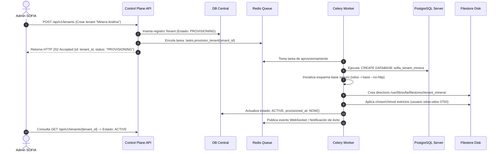

# Modelos de Arquitectura C4 y Flujos Dinámicos: SOFIA ERP

## 1. Nivel 1: Diagrama de Contexto del Sistema (System Context)

El diagrama de contexto ilustra cómo los distintos actores interactúan con la plataforma SOFIA ERP y sus sistemas externos asociados.



---

## 2. Nivel 2: Diagrama de Contenedores (Container Diagram)

Muestra los límites técnicos, tecnologías seleccionadas y protocolos de comunicación entre contenedores.

```mermaid
flowchart TB
    subgraph Edge["Perímetro de Seguridad (Nginx Ingress / Reverse Proxy)"]
        Nginx["Nginx Reverse Proxy & SSL Terminator\n(Lua / Dynamic Map / Certbot ACME)\nPuertos 80, 443"]
    end

    subgraph ControlPlaneContainer["Control Plane — SOFIA Platform (Monolito Modular)"]
        CP_API["FastAPI Application Server\n(Python 3.11, Uvicorn, Pydantic v2)\n• Tenant Resolver\n• Identity & OIDC\n• Catalog & Billing\n• Capacity Metering"]
        CP_Worker["Celery Background Worker\n(Python 3.11)\n• Tenant Provisioning\n• SSL Generation Task\n• Backup Orchestration"]
        CP_Beat["Celery Beat Scheduler\n• Subscription Renewals\n• Metrics Aggregation"]
    end

    subgraph RuntimePlaneContainer["Runtime Plane — SOFIA ERP (Odoo Runtimes)"]
        OdooShared["Odoo Community 18/20 Container Pool\n(Python 3.11, Werkzeug, Gevent/Workers)\n• Módulo sofia_auth_bridge\n• Módulo l10n_pe_edi_sunat\n• Addons de Negocio"]
        OdooDedicated["Dedicated Odoo Container\n(Para Clientes Enterprise)"]
    end

    subgraph DataPlaneContainer["Data Plane (Persistencia y Caché)"]
        PgBouncer["PgBouncer Connection Pooler\n(Gestión Eficiente de Descriptores)"]
        PostgresCentral[(PostgreSQL Central Database\nTenants, Subscriptions, Users, Audits)]
        PostgresTenants[(PostgreSQL Tenant Databases Cluster\nsofia_tenant_uuid1, sofia_tenant_uuid2)]
        RedisCache[(Redis In-Memory Data Store\nBroker Celery, Rate Limiting, Concurrencia)]
        FileStoreVolume["Volúmenes Locales Aislados\n/var/lib/sofia/filestores/tenant_id"]
    end

    %% Flujos de Red
    Nginx -->|Proxy HTTP :8000 /api, /auth, /admin| CP_API
    Nginx -->|Proxy HTTP :8069 con cabecera X-Odoo-dbfilter| OdooShared
    Nginx -->|Proxy HTTP :8069 (Ruta Dedicada)| OdooDedicated

    CP_API -->|Lectura / Escritura de Esquema Central| PostgresCentral
    CP_API -->|Caché de Sesiones y Locks Atómicos| RedisCache
    CP_API -->|Encola Tareas de Aprovisionamiento| RedisCache

    CP_Worker -->|Lee Tareas| RedisCache
    CP_Worker -->|DDL: CREATE DATABASE tenant_id| PostgresTenants
    CP_Worker -->|Crea directorios con permisos estrictos| FileStoreVolume

    OdooShared -->|Consultas SQL vía Pooler| PgBouncer
    OdooDedicated -->|Consultas SQL vía Pooler| PgBouncer
    PgBouncer --> PostgresTenants
    OdooShared -->|Lectura y Escritura de Adjuntos| FileStoreVolume
```

---

## 3. Nivel 3: Diagrama de Componentes del Control Plane (Component Diagram)

Detalla la arquitectura modular interna de la aplicación FastAPI.



---

## 4. Flujos de Secuencia Críticos

### 4.1 Flujo 1: Resolución Dinámica de Dominio y Tenant (Domain & Tenant Resolution)



### 4.2 Flujo 2: Aprovisionamiento Automatizado y Asíncrono de un Nuevo Tenant


