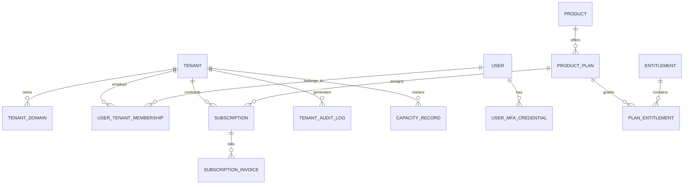

# Modelo de Datos del Control Plane (SOFIA Platform)

El esquema de la base de datos central de SOFIA Platform administra la metadata empresarial, identidad, dominios, catálogos, suscripciones, licencias, capacidad y auditoría.

## 1. Diagrama Entidad-Relación (ERD)

---

## 2. Definición Detallada de Entidades Relacionales

### 2.1 Entidad: `tenants`
Almacena el registro principal de cada cliente corporativo.

| Campo | Tipo SQL | Restricciones | Descripción |
| :--- | :--- | :--- | :--- |
| `id` | `UUID` | `PRIMARY KEY` | Identificador único global (UUIDv4). |
| `slug` | `VARCHAR(63)` | `UNIQUE, NOT NULL` | Identificador textual seguro para URL y nombre de BD. |
| `name` | `VARCHAR(150)` | `NOT NULL` | Razón social o nombre comercial del cliente. |
| `database_name` | `VARCHAR(63)` | `UNIQUE, NOT NULL` | Nombre físico de BD en PostgreSQL (`sofia_tenant_<slug>`). |
| `filestore_path` | `VARCHAR(255)` | `NOT NULL` | Ruta absoluta al filestore físico en disco. |
| `status` | `VARCHAR(30)` | `NOT NULL` | `PROVISIONING`, `ACTIVE`, `SUSPENDED`, `ARCHIVED`. |
| `runtime_mode` | `VARCHAR(30)` | `NOT NULL` | `SHARED_PROTECTED` o `DEDICATED`. |
| `dedicated_host`| `VARCHAR(255)` | `NULL` | Host de ejecución en caso de ser dedicado. |
| `created_at` | `TIMESTAMPTZ` | `NOT NULL, DEFAULT NOW()` | Marca temporal de creación. |
| `updated_at` | `TIMESTAMPTZ` | `NOT NULL, DEFAULT NOW()` | Marca temporal de actualización. |

### 2.2 Entidad: `tenant_domains`
Gestiona los dominios de entrada asociados a cada tenant.

| Campo | Tipo SQL | Restricciones | Descripción |
| :--- | :--- | :--- | :--- |
| `id` | `UUID` | `PRIMARY KEY` | Identificador único. |
| `tenant_id` | `UUID` | `FOREIGN KEY (tenants.id) ON DELETE CASCADE` | Tenant propietario. |
| `domain` | `VARCHAR(255)` | `UNIQUE, NOT NULL` | FQDN (ej. `erp.mineraandina.com`). |
| `is_primary` | `BOOLEAN` | `DEFAULT FALSE` | Indica si es el dominio principal de acceso. |
| `verification_token` | `VARCHAR(128)` | `NOT NULL` | Token para registro TXT (`_sofia-challenge`). |
| `status` | `VARCHAR(30)` | `NOT NULL` | `PENDING_DNS`, `VERIFIED`, `SSL_ACTIVE`, `REVOKED`. |
| `ssl_expires_at` | `TIMESTAMPTZ` | `NULL` | Fecha de expiración del certificado Let's Encrypt. |
| `verified_at` | `TIMESTAMPTZ` | `NULL` | Fecha de verificación DNS exitosa. |

### 2.3 Entidad: `users`
Identidad centralizada de usuarios a nivel de toda la plataforma.

| Campo | Tipo SQL | Restricciones | Descripción |
| :--- | :--- | :--- | :--- |
| `id` | `UUID` | `PRIMARY KEY` | Identificador del usuario. |
| `email` | `VARCHAR(255)` | `UNIQUE, NOT NULL` | Correo electrónico principal verificado. |
| `password_hash` | `VARCHAR(255)` | `NOT NULL` | Hash Argon2id o bcrypt de alta iteración. |
| `full_name` | `VARCHAR(150)` | `NOT NULL` | Nombre completo del usuario. |
| `is_active` | `BOOLEAN` | `DEFAULT TRUE` | Estado de habilitación global. |
| `is_superadmin`| `BOOLEAN` | `DEFAULT FALSE` | Flag de administrador de la plataforma SOFIA. |
| `created_at` | `TIMESTAMPTZ` | `NOT NULL, DEFAULT NOW()` | Creación. |

### 2.4 Entidad: `user_tenant_memberships`
Asocia usuarios con tenants y define su rol administrativo o acceso.

| Campo | Tipo SQL | Restricciones | Descripción |
| :--- | :--- | :--- | :--- |
| `id` | `UUID` | `PRIMARY KEY` | Identificador de membresía. |
| `user_id` | `UUID` | `FOREIGN KEY (users.id) ON DELETE CASCADE` | Usuario. |
| `tenant_id` | `UUID` | `FOREIGN KEY (tenants.id) ON DELETE CASCADE` | Tenant asociado. |
| `role` | `VARCHAR(50)` | `NOT NULL` | `TENANT_ADMIN`, `OPERATOR`, `AUDITOR`. |
| `is_enabled` | `BOOLEAN` | `DEFAULT TRUE` | Habilitación de acceso en ese tenant. |
| `created_at` | `TIMESTAMPTZ` | `NOT NULL, DEFAULT NOW()` | Fecha de asignación. |

### 2.5 Entidad: `products` y `product_plans`
Catálogo de productos de software y planes comerciales.

| Tabla | Campos Principales | Descripción |
| :--- | :--- | :--- |
| `products` | `id, code, name, description, is_active` | Productos comerciales (`sofia-erp`, `sofia-industrial`, `sofia-quality`, `sofia-projects`). |
| `product_plans` | `id, product_id, code, name, tier, max_users, max_concurrent_sessions, storage_gb_limit, base_price` | Planes (`BASIC`, `PROFESSIONAL`, `ENTERPRISE`). |

### 2.6 Entidad: `subscriptions`
Contratos comerciales activos entre tenants y productos.

| Campo | Tipo SQL | Restricciones | Descripción |
| :--- | :--- | :--- | :--- |
| `id` | `UUID` | `PRIMARY KEY` | Identificador de suscripción. |
| `tenant_id` | `UUID` | `FOREIGN KEY (tenants.id) ON DELETE RESTRICT` | Tenant contratante. |
| `plan_id` | `UUID` | `FOREIGN KEY (product_plans.id) ON DELETE RESTRICT` | Plan suscrito. |
| `status` | `VARCHAR(30)` | `NOT NULL` | `TRIAL`, `ACTIVE`, `PAST_DUE`, `SUSPENDED`, `CANCELLED`. |
| `current_period_start` | `TIMESTAMPTZ` | `NOT NULL` | Inicio de periodo facturado. |
| `current_period_end` | `TIMESTAMPTZ` | `NOT NULL` | Fin de periodo facturado. |
| `extra_users` | `INTEGER` | `DEFAULT 0` | Usuarios adicionales adquiridos. |
| `extra_storage_gb` | `INTEGER` | `DEFAULT 0` | Almacenamiento adicional contratado. |

### 2.7 Entidad: `entitlements` y `plan_entitlements`
Capacidades funcionales habilitadas por plan.

- Códigos iniciales de capacidades:
  - `custom_domain`: Soporte para FQDN del cliente.
  - `custom_login_branding`: Pantalla de acceso personalizada.
  - `custom_logo`: Logotipo corporativo inyectado en el ERP.
  - `custom_colors`: Paleta cromática corporativa.
  - `white_label`: Eliminación de referencias a marca SOFIA en pie de página y reportes.
  - `multiple_products`: Acceso a múltiples líneas de producto desde el portal unificado.
  - `advanced_support`: Soporte prioritario y canal de tickets directo.

### 2.8 Entidad: `capacity_records`
Medición histórica y en tiempo real del uso de recursos.

| Campo | Tipo SQL | Descripción |
| :--- | :--- | :--- |
| `id` | `UUID PRIMARY KEY` | Registro de telemetría. |
| `tenant_id` | `UUID NOT NULL` | Tenant medido. |
| `active_users_count` | `INTEGER` | Usuarios habilitados en el periodo. |
| `concurrent_sessions_peak` | `INTEGER` | Pico de sesiones concurrentes registradas en Redis. |
| `storage_bytes_used` | `BIGINT` | Espacio consumido en PostgreSQL + Filestore. |
| `measured_at` | `TIMESTAMPTZ` | Marca de tiempo de la medición. |

### 2.9 Entidad: `tenant_audit_logs`
Pista de auditoría inmutable de eventos críticos.

| Campo | Tipo SQL | Descripción |
| :--- | :--- | :--- |
| `id` | `UUID PRIMARY KEY` | Identificador de log. |
| `tenant_id` | `UUID NULL` | Tenant afectado (o NULL para eventos de plataforma). |
| `actor_user_id` | `UUID NULL` | Usuario que ejecutó la acción. |
| `action` | `VARCHAR(100) NOT NULL` | Acción (`TENANT_CREATED`, `DOMAIN_VERIFIED`, `MFA_ENABLED`, `BACKUP_RESTORED`). |
| `ip_address` | `INET NOT NULL` | Dirección IP de origen. |
| `user_agent` | `VARCHAR(255)` | Cadena del agente de usuario. |
| `payload_json` | `JSONB` | Detalles del cambio (valores previos y posteriores). |
| `created_at` | `TIMESTAMPTZ` | Timestamp inmutable. |
