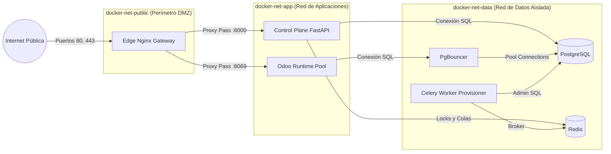

# Modelo de Seguridad, Aislamiento y Matriz de Amenazas: SOFIA ERP

## 1. Zonificación de Redes y Perímetros de Seguridad

Para garantizar que un compromiso en un componente web no conceda acceso a la base de datos ni a los secretos de la infraestructura, se implementa una topología de tres redes virtuales internas en Docker.

### Reglas de Zonificación:
1. **Sin exposición de puertos internos:** Ni PostgreSQL (`5432`), ni PgBouncer (`6432`), ni Redis (`6379`), ni Celery tienen mapeo de puertos hacia el host exterior (`0.0.0.0`).
2. **Sin Docker Socket en Contenedores:** Ningún contenedor de aplicación tiene acceso a `/var/run/docker.sock`. El aprovisionamiento se gestiona exclusivamente por API SQL y Celery Worker ejecutado con un usuario sin privilegios root.
3. **Credenciales Técnicas Segmentadas:** El usuario de base de datos de Odoo (`odoo_user`) carece de permisos `CREATEDB`, `CREATEROLE` o `SUPERUSER`. Solo el worker de aprovisionamiento posee permisos DDL para crear esquemas de bases de datos de tenants.

---

## 2. Matriz de Amenazas y Mitigación (STRIDE)

| Categoría STRIDE | Amenaza Identificada | Impacto | Estrategia de Mitigación Obligatoria en SOFIA |
| :--- | :--- | :--- | :--- |
| **Spoofing** (Suplantación) | Falsificación de cabecera `Host` para acceder a la base de datos de otro cliente (*Host Header Injection*). | Crítico | Nginx no delega la resolución a Odoo. Valida el Host en tabla estricta y reescribe la cabecera forzando `X-Odoo-dbfilter: ^sofia_tenant_<uuid>$`. |
| **Tampering** (Manipulación) | Manipulación de tokens de sesión para saltarse límites de licencias o planes. | Alto | Tokens JWT firmados criptográficamente con algoritmo asimétrico **RS256** emitidos por `auth.sofiaerp.com`. Claims verificados contra firma pública JWKS. |
| **Repudiation** (Repudio) | Usuario administrativo elimina registros contables o altera permisos y niega haberlo hecho. | Medio | Tabla inmutable `tenant_audit_logs` con IP, User-Agent, timestamp UTC, actor y payload diff (antes/después). Logs replicados a Loki. |
| **Information Disclosure** (Fuga de Información) | Error o vulnerabilidad en un módulo Odoo permite a un tenant consultar tablas de otra empresa. | Crítico | **Aislamiento Físico Database-per-Tenant:** No existe una base común. Un fallo en el código de Odoo no puede cruzar los límites del proceso/conexión PostgreSQL. |
| **Denial of Service** (Denegación de Servicio) | Tenant ejecuta consultas masivas o bucles infinitos que agotan las conexiones del servidor PostgreSQL. | Alto | PgBouncer con `max_db_connections` por base de datos, límites de tiempo por consulta (`statement_timeout = 30000ms`) y cuotas de memoria en el runtime. |
| **Elevation of Privilege** (Escalada de Privilegios) | Atacante compromete una instancia Odoo e intenta acceder al Control Plane o al servidor host. | Crítico | Runtimes Odoo corren en contenedores independientes sin credenciales del Control Plane ni montajes del sistema operativo anfitrión. |

---

## 3. Arquitectura de Identidad, OIDC y Tokens

1. **Flujo de Autorización:** OpenID Connect utilizando **Authorization Code Flow con PKCE** (Proof Key for Code Exchange) para prevenir intercepciones de códigos de autorización en clientes públicos o web.
2. **Tokens JWT Criptográficamente Seguros:**
   - Algoritmo: `RS256` (RSA con SHA-256) con par de claves asimétricas de 4096 bits.
   - Publicación de clave pública en endpoint estándar: `https://auth.sofiaerp.com/.well-known/jwks.json`.
   - Rotación programada de claves con soporte de múltiples `kid` (Key ID).
3. **MFA Obligatorio y Configurable:**
   - **Obligatorio:** Para todo rol con privilegio administrativo en SOFIA Platform o administrador del Tenant.
   - **Mecanismos Soportados:** TOTP (RFC 6238, compatible con Google Authenticator, Microsoft Authenticator, Bitwarden) y WebAuthn/Passkeys (FIDO2).
   - Se excluye expresamente el uso de SMS como canal de segundo factor por vulnerabilidad demostrada a SIM swapping.
