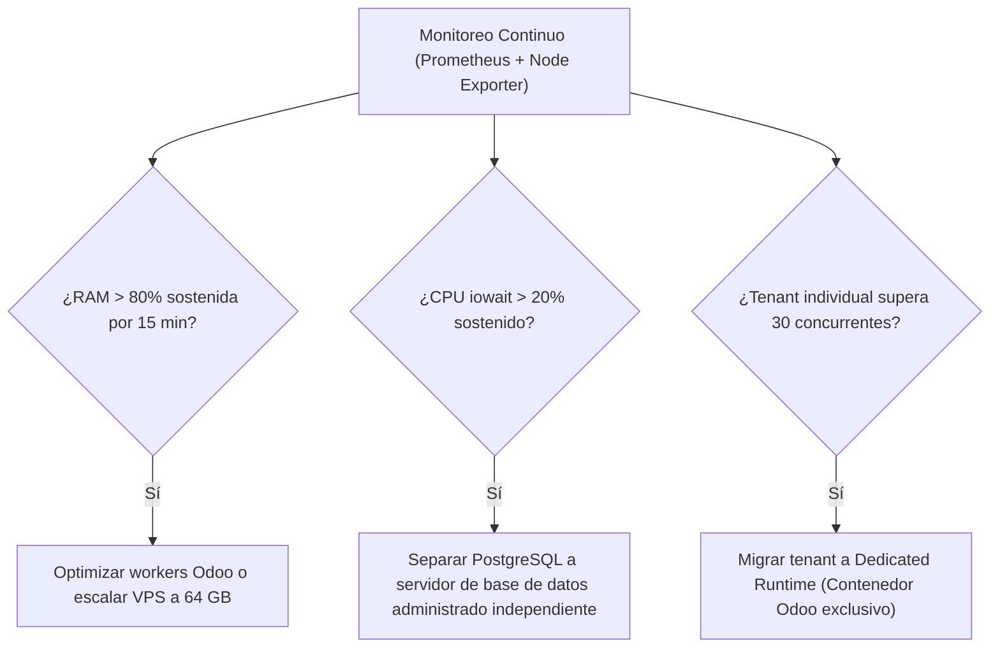

# Dimensionamiento de Infraestructura y Capacidad Inicial: MVP 10 Clientes

## 1. Perfil de Carga del MVP (10 Clientes Comerciales)

Para el lanzamiento comercial inicial, el dimensionamiento se calcula con base en un escenario conservador de pequeñas y medianas empresas:

- **Número de Tenants:** 10 empresas clientes.
- **Usuarios Habilitados por Empresa:** Promedio de 5 a 10 usuarios por tenant (Total: 50 - 100 usuarios registrados).
- **Usuarios Concurrentes Activos (Pico):** Estimado en 20% a 30% simultáneo = **15 a 30 usuarios concurrentes totales** interactuando en la plataforma en horas pico.
- **Volumen Transaccional Estimado:** 50 a 200 comprobantes electrónicos (facturas/boletas) diarios por empresa.

---

## 2. Especificación de Infraestructura Física Recomendada

Para evitar la complejidad prematura de clusters distribuidos o Kubernetes en el MVP, se selecciona un despliegue **Single-Node VPS Hardened** con backups externos automatizados en almacenamiento S3 compatible.

### Servidor de Producción Principal (VPS / Instancia Cloud Dedicada)
- **CPU:** 8 vCPU (AMD EPYC o Intel Xeon de alta frecuencia > 2.8 GHz).
- **Memoria RAM:** 16 GB a 32 GB DDR4/DDR5 con ECC.
- **Almacenamiento Local:** 160 GB - 300 GB SSD NVMe en RAID 1 (I/O de alto rendimiento para PostgreSQL).
- **Conectividad:** 1 Gbps con transferencia ilimitada o >= 10 TB/mes.
- **Sistema Operativo:** Ubuntu Server 24.04 LTS o Debian 12 con kernel optimizado.

### Presupuesto y Asignación de Memoria RAM

| Componente | Memoria Asignada | Justificación Técnica |
| :--- | :--- | :--- |
| **PostgreSQL 16 + PgBouncer** | 6.0 GB | `shared_buffers = 2GB`, `work_mem = 16MB`, caché de sistema operativo. |
| **Odoo Shared Runtime Pool** | 6.0 GB | 6 a 8 workers gevent/http (`limit_memory_hard = 1024MB`, `limit_memory_soft = 800MB`). |
| **Control Plane (FastAPI + Uvicorn)** | 1.0 GB | 2 procesos Uvicorn asíncronos para APIs y autenticación. |
| **Celery Workers (Aprovisionamiento)** | 1.0 GB | 2 workers concurrentes para tareas pesadas y generación de esquemas. |
| **Redis In-Memory Store** | 0.5 GB | Sesiones volátiles, rate limiting y broker de colas. |
| **Nginx Edge Gateway** | 0.5 GB | Manejo de terminación TLS, compresión gzip/brotli y conexiones keepalive. |
| **Observabilidad (Prometheus + Loki)** | 2.0 GB | Recolección de métricas y retención de logs en disco. |
| **Buffer Libre del SO / Page Cache** | 3.0 GB | Margen de seguridad para I/O del kernel y operaciones de snapshot. |
| **TOTAL** | **20.0 GB** | **Encaja confortablemente en una instancia de 24 GB o 32 GB RAM.** |

---

## 3. Almacenamiento Externo y Backups

- **Proveedor S3 Compatible:** Backblaze B2, Cloudflare R2 o Wasabi (Bajo costo y sin tarifas de egreso abusivas).
- **Capacidad Contratada:** 250 GB iniciales.
- **Estrategia de Respaldo:**
  - Respaldo diario completo de bases de datos PostgreSQL cifrado con GPG.
  - Sincronización continua de WAL (Write-Ahead Logging) para permitir Point-In-Time Recovery (PITR) en planes Enterprise.
  - Sincronización incremental del filestore físico mediante `rclone` / `restic`.

---

## 4. Análisis de Cuellos de Botella y Umbrales de Crecimiento

### Criterios de Separación de Servicios (Triggers de Desacoplamiento):
1. **Desacoplamiento de Base de Datos:** Cuando el número de tenants supere los 25 clientes, la base de datos PostgreSQL se extraerá del nodo único a una instancia dedicada de base de datos con volúmenes NVMe dedicados.
2. **Desacoplamiento de Runtimes:** Cuando un cliente contrata el plan *Empresarial* o supera 25 usuarios concurrentes, se activa la directiva de *Dedicated Runtime* (un contenedor Odoo con recursos garantizados mediante cgroups de Docker).
