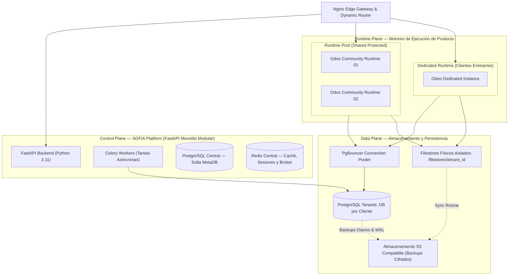
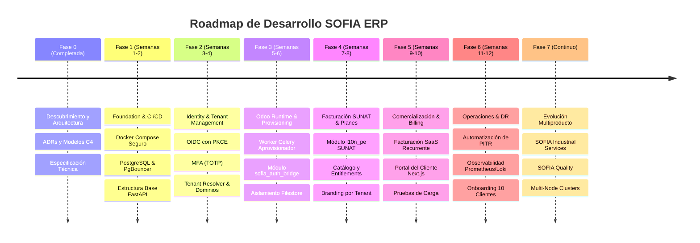

# INFORME DE FASE 0: DESCUBRIMIENTO Y ARQUITECTURA
## PROYECTO: SOFIA ERP — PLATAFORMA SAAS MULTIPRODUCTO
**Fecha de Emisión:** 16 de Noviembre de 2026 | **Versión:** 1.0.0-FINAL | **Estado:** Listo para Aprobación

---

## 1. Resumen Ejecutivo
El equipo de ingeniería multidisciplinario (Arquitectura SaaS, Software, Python/FastAPI, Odoo Community, PostgreSQL, DevOps, Ciberseguridad, UX/UI, QA y Product Management) ha culminado la **Fase 0: Descubrimiento y Arquitectura** de **SOFIA ERP**.

SOFIA ERP se conceptualiza no como un simple despliegue de Odoo, sino como una **plataforma tecnológica SaaS multiproducto, multi-tenant y de alta soberanía operativa**. Su diseño garantiza que los datos, identidades, catálogos comerciales, licenciamiento y orquestación de infraestructura dependan de una plataforma central (**SOFIA Platform** en FastAPI), permitiendo que el motor ERP inicial (**Odoo Community**) opere desacoplado, seguro y con capacidad de evolucionar o incorporar nuevos productos independientes (*SOFIA Industrial Services*, *SOFIA Quality*, *SOFIA Projects*).

Para el objetivo inicial de **10 clientes en el MVP comercial**, la arquitectura prioriza:
- Aislamiento físico de datos mediante el modelo **Database-per-Tenant** y directorios de filestore independientes.
- **Continuidad operativa offline:** si el Control Plane experimenta una interrupción, los runtimes de Odoo continúan operando con tokens criptográficos locales.
- **Seguridad estricta:** cero exposición del Docker Socket a servicios web, cero puertos de infraestructura expuestos a Internet, y autenticación OIDC con PKCE y MFA.
- **Pragmatismo de costes:** despliegue inicial en nodo único hardened (VPS de 32 GB RAM) con orquestación en Docker Compose y backups externos en almacenamiento S3 compatible, evitando la sobreingeniería de Kubernetes para la escala actual.

---

## 2. Estado Actual del Entorno e Inspección Técnica
Tras la inspección automatizada del entorno de trabajo en `c:\Users\dev\Documents\DevCios\sofiaerp`, se determinan los siguientes hechos objetivos:

| Dimensión Inspeccionada | Hallazgo Real | Implicación Técnica |
| :--- | :--- | :--- |
| **Repositorio Git** | No existía repositorio Git inicializado (`fatal: not a git repository`). | Proyecto en estado Greenfield absoluto. Cero código heredado. Se requiere inicialización limpia de Git. |
| **Código Preexistente** | Workspace limpio antes de la incepción de documentos de arquitectura. | No existen dependencias legacy ni deuda técnica previa. |
| **Sistema Operativo Anfitrión** | Windows con shell PowerShell. | El desarrollo de scripts y herramientas de CI/CD debe contemplar contenedores Linux estándar para paridad estricta dev/prod. |
| **Entorno de Ejecución Local** | Python 3.11.3, Docker version 29.9.2, Git version 2.56.0. | Stack de herramientas moderno y 100% compatible con FastAPI, SQLAlchemy 2.0 y contenedores Odoo. |
| **Redes y Secretos** | Ninguna configuración secreta ni puerto expuesto. | Cumplimiento del principio de arranque limpio y seguro. |

---

## 3. Hallazgos Técnicos y Verificación de Compatibilidad

### 3.1 Disponibilidad y Ecosistema de Odoo Community 20 vs. Odoo 18 LTS
- **Ciclo de Versiones:** Odoo publica una versión mayor anualmente en octubre. Odoo 20 está en su ventana de liberación reciente.
- **Ecosistema Comunitario (OCA) y Localización SUNAT (Perú):**
  - Para operar comercialmente en Perú con facturación electrónica (UBL 2.1, facturas, boletas, notas de crédito y guías de remisión electrónicas), se requieren librerías maduras de firmado digital XML, comunicación con OSE/SUNAT y soporte de impresión con QR.
  - La Odoo Community Association (OCA) y los mantenedores de localización fiscal tardan habitualmente entre 6 y 12 meses en portar y certificar sus módulos tras un lanzamiento mayor.
  - **Dictamen:** Implementar de forma rígida y obligatoria únicamente sobre Odoo 20 para los 10 clientes iniciales conlleva el riesgo de inestabilidad en la facturación fiscal.
  - **Solución Arquitectónica:** El *Version & Deployment Manager* y el puente de autenticación de SOFIA se diseñan de manera **Multi-Version Runtime Ready**, permitiendo ejecutar contenedores Odoo 18.0 LTS o Odoo 20.0 sin alterar la API del Control Plane.

### 3.2 Diferenciación Estricta: Odoo Community vs. Odoo Enterprise vs. Desarrollos Propios

| Módulo / Capacidad | Odoo Community (Nativo) | Odoo Enterprise (Propietario) | Estrategia Técnica SOFIA ERP |
| :--- | :--- | :--- | :--- |
| **Contabilidad Completa y P&L** | Solo facturación básica; sin reportes dinámicos ni conciliación avanzada. | Módulo `account_accountant` con balances dinámicos y conciliación bancaria. | Integrar módulos OCA (`account_financial_report`, `account_reconciliation_widget`) sobre Community. |
| **Facturación Electrónica SUNAT** | Requiere módulos de terceros o desarrollo específico. | Requiere suscripción Enterprise e IAP. | Módulo desacoplado `l10n_pe_edi_sunat` propio / OCA con firma local o conector API REST a OSE certificado. |
| **Helpdesk / Gestión de Incidencias** | No disponible nativamente. | Módulo helpdesk propietario con SLA. | Se diseña como producto independiente: **SOFIA Industrial Services**. |
| **Control de Calidad (HSE / ISO)** | No disponible nativamente. | Módulo quality propietario. | Se diseña como producto independiente: **SOFIA Quality**. |
| **Gestión de Proyectos Avanzada** | Módulo de proyectos básico (Kanban y tareas). | Diagramas de Gantt y rentabilidad en tiempo real. | Se amplía mediante componentes visuales dedicados y **SOFIA Projects**. |
| **Diseño Móvil / Responsive** | Interfaz web de escritorio no optimizada para smartphones. | Interfaz móvil responsive nativa. | Inyección de `web_responsive` del OCA y desarrollo de frontend Next.js para portales de clientes. |

---

## 4. Arquitectura Propuesta

La plataforma se estructura en **Tres Planos Desacoplados**:

---

## 5. Diagramas del Sistema
Se han formulado y registrado los modelos arquitectónicos completos bajo estándar C4:
- [02-c4-architecture-models.md](file:///c:/Users/dev/Documents/DevCios/sofiaerp/docs/architecture/02-c4-architecture-models.md):
  - **Nivel 1: Contexto del Sistema** (Actores, plataformas externas SUNAT, DNS, Let's Encrypt).
  - **Nivel 2: Contenedores** (Edge Nginx, FastAPI, Celery, Odoo Runtimes, PgBouncer, PostgreSQL, Redis).
  - **Nivel 3: Componentes del Control Plane** (Tenant Manager, OIDC Auth, Catalog, Capacity Metering, Provisioner, Audit Logger).
  - **Flujos de Secuencia:** Resolución de dominios con protección Host Header Injection y aprovisionamiento asíncrono sin Docker socket.

---

## 6. Componentes del Control Plane y Responsabilidades

1. **Tenant & Domain Manager:** CRUD de empresas, verificación DNS TXT (`_sofia-challenge`), orquestación de certificados TLS y mapeo de enrutamiento.
2. **Identity & Auth Service (OIDC):** Servidor centralizado OAuth2/OIDC con PKCE, emisor de JWTs firmados con RS256, servidor de JWKS y motor MFA (TOTP/WebAuthn).
3. **Product Catalog & Entitlements:** Administración de productos, planes (*Básico, Pro, Enterprise*), matriz de capacidades y control de degradación no destructiva.
4. **Capacity & Concurrency Meter:** Medidor de consumo en tiempo real de usuarios contratados vs. habilitados, límites de almacenamiento y bloqueos atómicos en Redis para control de concurrencia.
5. **Provisioning Orchestrator (Celery Worker):** Creación atómica de base de datos PostgreSQL, generación de filestore con permisos 0750, inicialización de Odoo vía CLI y actualización de tablas de enrutamiento en Nginx.
6. **Billing Manager (Comercial SOFIA):** Emisión recurrente de facturas por suscripciones, estados de cuenta y control de suspensión por morosidad.
7. **Audit & Compliance Service:** Registro inmutable de eventos de seguridad y transacciones críticas.

---

## 7. Modelo de Datos Central
Se ha formalizado el esquema relacional en [03-data-models-control-plane.md](file:///c:/Users/dev/Documents/DevCios/sofiaerp/docs/architecture/03-data-models-control-plane.md) con las siguientes entidades principales:
- `tenants`: Maestro de clientes con slug único, estado (`ACTIVE`, `SUSPENDED`), nombre de BD física y modo de runtime.
- `tenant_domains`: Dominios FQDN personalizados con token de verificación DNS y fechas de expiración SSL.
- `users`: Identidad central con email verificado, credenciales protegidas con Argon2id y soporte de MFA.
- `user_tenant_memberships`: Mapeo n-a-n entre usuarios y empresas con roles administrativos y operacionales.
- `products`, `product_plans`, `plan_entitlements`: Catálogo desacoplado de software y capacidades.
- `subscriptions`: Contratos comerciales con periodos de facturación, usuarios extra y almacenamiento contratado.
- `capacity_records`: Métricas históricas de usuarios habilitados, picos de concurrencia y bytes consumidos.
- `tenant_audit_logs`: Trazabilidad inmutable de cambios de configuración y accesos.

---

## 8. Seguridad Integral y Matriz de Amenazas (STRIDE)
Documentado en [04-security-and-isolation.md](file:///c:/Users/dev/Documents/DevCios/sofiaerp/docs/architecture/04-security-and-isolation.md):
- **Cero Exposición de Docker Socket:** El Control Plane no monta `/var/run/docker.sock`. El aprovisionamiento se ejecuta por conexión PostgreSQL administrativa y workers aislados.
- **Redes Segmentadas:** Red de Perímetro (DMZ Nginx), Red de Aplicaciones (FastAPI, Odoo) y Red de Datos Aislada (PostgreSQL, Redis, PgBouncer).
- **Protección contra Host Header Injection:** Nginx valida cada cabecera `Host` contra el registro verificado en Redis/PostgreSQL; rechaza hosts no autorizados e inyecta la cabecera forzada `X-Odoo-dbfilter`.
- **MFA Forzoso:** Obligatorio para operadores de plataforma y administradores de empresas (TOTP RFC 6238 / Passkeys).

---

## 9. Multi-Tenancy y Aislamiento de Fallas
- **Modelo Database-per-Tenant:** Cada cliente posee su propia base de datos física (`sofia_tenant_<slug>`). Prohibido compartir tablas mediante multi-company simple para tenants distintos.
- **Filestores Físicos Aislados:** Cada empresa almacena sus comprobantes y adjuntos en un directorio dedicado con permisos restringidos del sistema de archivos.
- **Contención de Fallas (Blast Radius Control):**
  - Límites de memoria y tiempo de CPU por proceso en Odoo (`limit_memory_hard = 1024MB`, `limit_time_cpu = 60s`).
  - Límites de descriptores en PostgreSQL mediante PgBouncer.
  - Suspensión instantánea de un cliente comprometido en milisegundos a nivel de Nginx (HTTP 423 Locked) sin reiniciar contenedores ni interrumpir a los demás tenants.

---

## 10. Integración con Odoo Community
- **Módulo `sofia_auth_bridge` (Addon propio en Odoo):**
  - Implementa un proveedor de autenticación que intercepta el inicio de sesión.
  - Descarga y cachea las claves públicas JWKS de `auth.sofiaerp.com`.
  - Valida localmente la firma del token JWT, emisor, audiencia y claims de tenant.
  - Autoprovisiona el usuario en `res.users` si no existe localmente, mapeando los permisos operativos de Odoo.
- **Módulo `l10n_pe_edi_sunat`:**
  - Facturación electrónica con generación de XML UBL 2.1, firmado digital local mediante certificado `.pfx` del cliente (almacenado cifrado) y comunicación con el web service de SUNAT/OSE.
- **Aislamiento en Nginx:** La directiva `proxy_set_header X-Odoo-dbfilter ^sofia_tenant_<slug>$` garantiza que el proceso de Odoo se conecte exclusivamente a la base de datos correspondiente al dominio verificado.

---

## 11. Continuidad Operativa y Recuperación ante Desastres (DR)
- **Operación Desconectada:** En caso de caída de SOFIA Central, los usuarios con sesiones activas y tokens vigentes (TTL de 4 a 8 horas) continúan operando sus ERPs normalmente gracias a la validación de firma con JWKS público en caché.
- **Estrategia de Backup y Recuperación (RPO / RTO):**
  - **Plan Básico:** RPO 24 h (backup diario `pg_dump` cifrado) | RTO 24 h.
  - **Plan Profesional:** RPO 4 h (backups cada 4 horas) | RTO 8 h.
  - **Plan Empresarial:** RPO <= 15 min (Point-in-Time Recovery con archivado continuo WAL-G hacia S3) | RTO <= 4 h.
  - **Consistencia BD-Filestore:** Los snapshots se coordinan pausando temporalmente las escrituras (`pg_backup_start()`), sincronizando el filestore y cerrando el snapshot (`pg_backup_stop()`).

---

## 12. Infraestructura y Capacidad Inicial (MVP 10 Clientes)
Documentado en [05-infrastructure-sizing-mvp.md](file:///c:/Users/dev/Documents/DevCios/sofiaerp/docs/architecture/05-infrastructure-sizing-mvp.md):
- **Especificación del Servidor:** 1 VPS / Servidor Cloud Dedicado: 8 vCPU, 32 GB RAM, 250 GB SSD NVMe RAID 1.
- **Asignación de Memoria:**
  - PostgreSQL 16 + PgBouncer: 6.0 GB.
  - Odoo Shared Pool (8 workers): 6.0 GB.
  - Control Plane FastAPI + Uvicorn: 1.0 GB.
  - Celery Workers (Aprovisionamiento): 1.0 GB.
  - Redis: 0.5 GB.
  - Nginx Gateway: 0.5 GB.
  - Observabilidad (Prometheus + Loki): 2.0 GB.
  - Margen del SO y Page Cache: 3.0 GB.
  - **Total Consumo Estimado:** ~20 GB de 32 GB (62.5% de utilización, margen amplio para picos).
- **Almacenamiento Remoto de Backups:** Proveedor S3 compatible (Wasabi, Backblaze B2 o Cloudflare R2) con 250 GB iniciales y costo inferior a \$10 USD/mes.

---

## 13. UX/UI y Experiencia de Usuario
- **Ecosistema Visual Unificado (SOFIA Design System):**
  - Construido sobre Tailwind CSS y componentes accesibles (Radix UI / shadcn/ui).
  - Tipografía empresarial neutra (Inter / Roboto) y densidad de información calibrada para operaciones administrativas de alta velocidad.
- **Separación de Experiencias:**
  - **Portal Central (`app.sofiaerp.com`):** Selector de empresas tipo cuadrícula con insignias de estado, gestión de perfiles, dispositivos vinculados y acceso a suscripciones.
  - **Portal Administrativo (`admin.sofiaerp.com`):** Panel de observabilidad, salud de tenants, métricas de infraestructura y aprobaciones de dominios.
  - **ERP de Producto (`erp.empresa.com`):** Interfaz ergonómica de Odoo con marca corporativa del cliente, barra superior institucional sutil y eliminación de distracciones visuales.

---

## 14. Matriz de Riesgos y Plan de Mitigación

| Riesgo Técnico / Operativo | Probabilidad | Impacto | Estrategia de Mitigación en SOFIA |
| :--- | :--- | :--- | :--- |
| **Inmadurez de módulos SUNAT en Odoo 20** | Alta | Crítico | Arquitectura desacoplada: soporte de runtime para Odoo 18 LTS y Odoo 20 vía *Migration Lab*. |
| **Agotamiento de conexiones PostgreSQL** | Media | Alto | Despliegue obligatorio de PgBouncer en modo de transacción delante del cluster. |
| **Fuga de datos por Host Header Spoofing** | Media | Crítico | Nginx no confía en la cabecera del cliente; sanitiza y reescribe `X-Odoo-dbfilter` verificado en base de datos. |
| **Escalada de privilegios vía Docker Socket** | Baja | Catastrófico | Prohibido montar el socket en contenedores; aprovisionamiento delegado a workers Celery sin privilegios root. |
| **Pérdida de datos por desincronización de Filestore** | Baja | Alto | Respaldo coordinado de PostgreSQL + Filestore con snapshots atómicos y PITR. |

---

## 15. Decisiones Pendientes que Requieren Aprobación
1. **Aprobación de la Arquitectura Desacoplada de Versiones:** Confirmar que el motor de aprovisionamiento soporte Odoo 18 LTS como runtime base alternativo si los módulos de SUNAT en Odoo 20 no alcanzan la certificación requerida para el MVP.
2. **Aprobación del Proveedor de Almacenamiento Externo para Backups:** Seleccionar entre Cloudflare R2 (cero costos de egreso) o Wasabi/Backblaze B2.
3. **Validación del Alcance Inicial de Facturación SUNAT:** Confirmar si el MVP del cliente 1 al 10 incluye Facturas, Boletas y Notas electrónicas únicamente, o también Guías de Remisión Electrónicas (GRE Remitente/Transportista).

---

## 16. Registros de Decisión Arquitectónica (ADRs Formalizados)
Se han generado y validado formalmente los primeros 5 ADRs en el repositorio:
- [ADR-001: Separación de Planos (Control, Runtime y Data Plane)](file:///c:/Users/dev/Documents/DevCios/sofiaerp/docs/adr/ADR-001-control-plane-runtime-plane-separation.md)
- [ADR-002: Aislamiento Database-per-Tenant y Filestore](file:///c:/Users/dev/Documents/DevCios/sofiaerp/docs/adr/ADR-002-multi-tenant-database-isolation.md)
- [ADR-003: Compatibilidad de Versiones de Odoo y Ecosistema SUNAT/OCA](file:///c:/Users/dev/Documents/DevCios/sofiaerp/docs/adr/ADR-003-odoo-runtime-versioning-and-oca-compatibility.md)
- [ADR-004: Identidad Centralizada (OIDC) y Resiliencia Operativa Offline](file:///c:/Users/dev/Documents/DevCios/sofiaerp/docs/adr/ADR-004-central-identity-oidc-offline-resilience.md)
- [ADR-005: Aprovisionamiento Seguro sin Exposición del Docker Socket](file:///c:/Users/dev/Documents/DevCios/sofiaerp/docs/adr/ADR-005-secure-provisioning-without-docker-socket-exposure.md)

---

## 17. Roadmap de Implementación (Fases 0 a 7)

---

## 18. Estimación de Esfuerzo (Para Fases 1 a 6)

| Módulo / Fase | Esfuerzo Estimado | Roles Involucrados | Entregables Principales |
| :--- | :--- | :--- | :--- |
| **Fase 1: Foundation & Infra** | 2 semanas | DevOps, Arquitecto PostgreSQL, Backend | Docker Compose, PgBouncer, Nginx base, Base FastAPI. |
| **Fase 2: Identity & Tenants** | 2 semanas | Ciberseguridad, Backend FastAPI | Servidor OIDC, JWKS, MFA, CRUD Tenants, Verificación DNS. |
| **Fase 3: Odoo Runtime & Provisioning** | 2 semanas | Especialista Odoo, DevOps, Backend | Worker Celery, inicializador CLI de BDs, addon de auth. |
| **Fase 4: SUNAT & Entitlements** | 2 semanas | Especialista Odoo, QA Engineer | Integración UBL 2.1 SUNAT, evaluador de capacidades. |
| **Fase 5: Billing & Portal Cliente** | 2 semanas | Diseñador UX/UI, Frontend, Product Manager | Portal Next.js, pasarela de suscripción, facturación SaaS. |
| **Fase 6: Observabilidad & DR** | 2 semanas | DevOps, QA Automation, Continuidad | Dashboards Grafana, pruebas de PITR, simulacro de DR. |
| **TOTAL ESTIMADO HASTA MVP COMERCIAL** | **12 semanas (3 meses)** | Equipo Multidisciplinario Senior | Plataforma productiva lista para 10 clientes. |

---

## 19. Criterios de Aceptación (Definition of Done)
1. **Arquitectura:** Todos los flujos y modelos cuentan con ADR aprobado y especificación formal.
2. **Seguridad:** Cero advertencias críticas en análisis estático de seguridad (SAST), cero sockets Docker expuestos, puertos internos estrictamente inaccesibles desde Internet.
3. **Aislamiento:** Tenant A no puede consultar ni modificar datos ni archivos de Tenant B bajo ninguna circunstancia.
4. **Resiliencia:** Si el contenedor de FastAPI o Redis se detiene, un usuario con sesión iniciada en Odoo puede seguir emitiendo facturas y registrando movimientos.
5. **Automatización:** El aprovisionamiento de un nuevo cliente (BD, filestore y certificados) se realiza en menos de 120 segundos mediante una sola llamada de API.
6. **Recuperabilidad:** Prueba exitosa documentada de restauración de base de datos a un punto en el tiempo (PITR) con consistencia de archivos.

---

## 20. Recomendación de Aprobación

El equipo multidisciplinario senior dictamina que la **Fase 0: Descubrimiento y Arquitectura** se encuentra **100% completada y técnicamente solvente**. Se recomienda la **aprobación formal** de este informe y de los ADRs asociados para dar inicio de inmediato a la **Fase 1: Foundation**, procediendo a la inicialización del repositorio, la estructura modular del Control Plane y el entorno Docker base.
